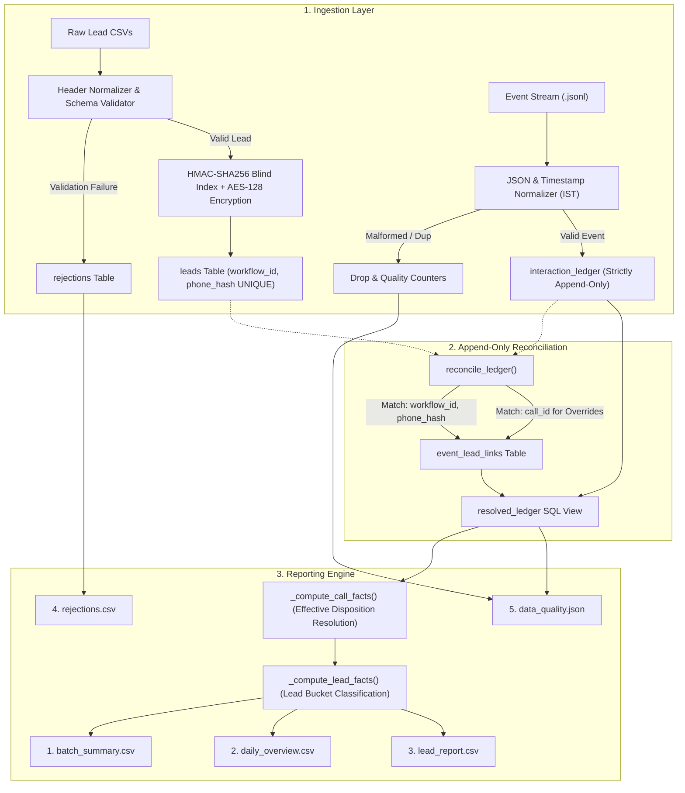

# Assignment A: Interaction Ledger & Reporting Pipeline

## 📌 Overview
Production-ready data ingestion and reporting pipeline built for Agentic Universe. The system processes messy client lead batches and telephony event streams into a strictly immutable, append-only interaction ledger to derive exact campaign metrics, call connectivity rates, and customer disposition outcomes.

---

## 🏗️ Architecture & Data Flow



---

## 🔒 Key Engineering Highlights

### 1. Provably Append-Only Ledger
- `interaction_ledger` stores only raw, immutable event facts.
- **Engine-Level Enforced:** SQLite database triggers (`trg_ledger_prevent_update`, `trg_ledger_prevent_delete`) raise fatal exceptions on any attempt to execute `UPDATE` or `DELETE` statements on the ledger.
- Reconciliation links are decoupled into `event_lead_links` and queried seamlessly via the `resolved_ledger` SQL view.

### 2. True Content-Hash Idempotency
- Tracks file contents by computing **SHA-256 hashes** (`hashlib.sha256(content_bytes).hexdigest()`) stored as primary keys in `ingested_files`.
- Guarantees zero duplicate records and identical reporting metrics even if files are renamed, moved across directories, or re-ingested with differing relative paths.

### 3. PII Protection at Rest
- Sensitive fields (`phone`, `customer_name`) are never stored in plaintext.
- **HMAC-SHA256 Blind Index (`phone_hash`):** Deterministic salt-hashed index allows indexed $O(1)$ SQL joins and lead lookups across drops without exposing phone numbers.
- **Authenticated Symmetric Encryption:** Raw customer names and canonical phone numbers are encrypted with AES-128-CBC + HMAC authentication (`Fernet`).
- **Masked Format:** Reports exclusively display masked numbers (`+91******XXXX`).

### 4. Robust Normalization & Schema Enforcement
- **Headers:** Case-insensitively trimmed, collapsed whitespace/underscores, matched against schema fields and aliases.
- **Dates:** Day-first priority (`YYYY-MM-DD`, `DD/MM/YYYY`, `DD-MM-YYYY`, `DD-Mon-YYYY`) with strict Gregorian calendar validation (rejects invalid dates like `31/02/2026`).
- **Timestamps:** Standardized to timezone-aware Indian Standard Time (**IST**, `UTC+05:30`).
- **Effective Dispositions:** Prioritizes human supervisor overrides (`disposition.override`) by latest `occurred_at`, falling back to automated agent outcomes (`disposition.set`).

---

## 🚀 Execution & Verification

### Setup
```bash
python -m venv .venv
# Windows: .venv\Scripts\activate | Unix: source .venv/bin/activate
pip install -r requirements.txt
```

### Ingest & Generate Reports
```bash
# 1. Ingest drops sequentially
python -m solution ingest data/drop_1
python -m solution ingest data/drop_2

# 2. Generate final contract reports
python -m solution report --out reports/
```

### Automated Test Suite
```bash
python -m pytest
```
**Results:** `19 passed in 2.37s` covering:
- Deterministic HMAC blind index & Fernet roundtrip
- Plaintext PII leak verification in raw SQLite tables
- Trigger-enforced ledger immutability (`UPDATE`/`DELETE` rejection)
- Content-hash idempotency across file copies
- Schema-order rejection priority and lead duplicate merging
- Cross-drop orphan reconciliation (events arriving before leads, phone-less overrides)
- Single-pass vs. incremental execution equivalence (Spec Rule #5)
